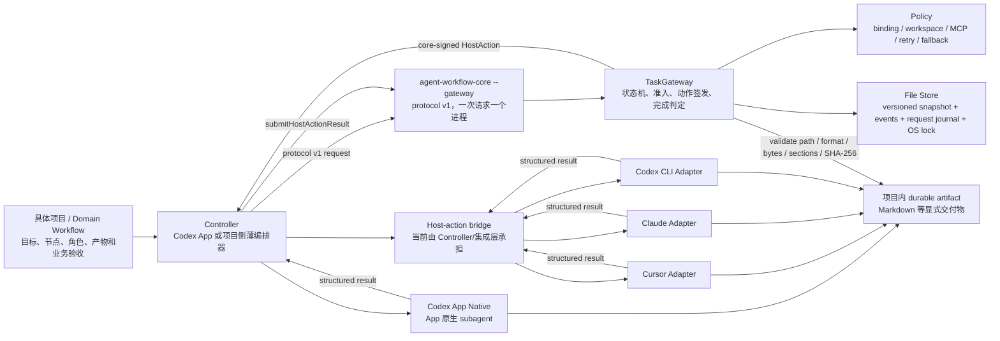
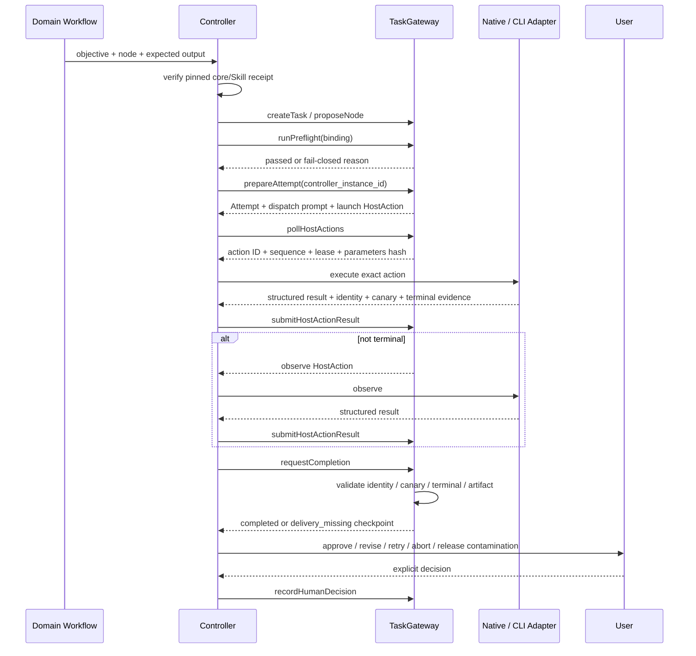

# 多 Agent 协同框架架构说明

- 文档用途：技术讨论、方案评审和阶段汇报
- 当前成熟度：`experimental`
- 当前能力边界：Codex App Native、Cursor Agent、Claude Code、Codex CLI 四条受控只读执行路径
- 验收基线：Wave 0–4 `experimental` + project-adoption hardening；Wave 5 领域试点尚未启动

## 1. 执行摘要

这套框架不是“让多个 Agent 自由聊天”的群聊系统，而是一套证据驱动、默认带人工检查点的轻量编排内核：

- 具体项目定义任务目标、Workflow 节点和交付物；
- Go `TaskGateway` 保存唯一状态并决定是否允许派发、重试、fallback、完成和继续；
- Controller 只执行核心签发的 `HostAction`，不维护第二套状态机；
- Native 或外部 CLI Adapter 负责把统一执行意图映射到具体宿主；
- Provider 退出、Agent 自述成功或 tool payload 都不直接等于完成；
- identity、workspace、session、task canary、terminal event 和 durable artifact 共同构成完成证据；
- 节点完成后默认停在人工检查点，用户批准后才可进入下一个节点。

因此，它解决的核心问题是“如何可靠地派发、恢复和验收一次 Agent 执行”，而不是提供 daemon、看板、长驻队列或生产级自治平台。

## 2. 总体架构



架构上分为四个平面：

| 平面 | 主要职责 | 当前实现 |
| --- | --- | --- |
| Domain | 定义业务目标、节点语义、角色、Prompt、交付物和业务验收 | 具体项目仓库，不进入共享核心 |
| Control | Task/Revision/Node/Attempt 状态、准入、动作签发、检查点、完成判定 | `internal/gateway/`、`internal/policy/`、`internal/orchestration/` |
| Execution | 宿主能力调用、CLI argv/env、stream 解析、进程取消、session resume | `internal/adapters/` 与 Codex App Native Controller |
| Evidence | snapshot、append-only event、request receipt、artifact hash、review/smoke | `internal/storage/`、项目交付路径、`tests/orchestration/evidence/` |

## 3. 组件职责与边界

### 3.1 Domain Workflow

具体项目负责回答：

- 本次任务要解决什么问题；
- 节点是 `explore`、`review` 还是其他明确语义；
- 允许哪些角色、Adapter、model、Reasoning 和权限组合；
- 最终交付物写到哪里、格式是什么、必须包含哪些章节；
- 什么结果可以被业务方接受。

共享仓库不接收业务 Prompt、领域术语和业务验收规则。领域仓库可以调用本框架，本框架不反向依赖领域仓库。

### 3.2 Controller

Controller 是宿主与核心之间的薄桥接层。当前 Codex App Native 参考入口是 [`skills/multi-agent-orchestration/SKILL.md`](../../skills/multi-agent-orchestration/SKILL.md)。它必须：

1. 在消费仓库从 `.agents/skills/multi-agent-orchestration` 加载 Skill，并在首个请求前核验 `.agents/agent-workflow-toolkit.lock.json`；
2. 调用 Gateway 创建 Task/Node/Attempt；
3. 展示核心返回的实际派发 binding；
4. 只执行 `pollHostActions` 返回的 pending action；
5. 原样保留 action ID、sequence、lease 和 parameters hash；
6. 把结构化结果提交给核心；
7. 在 `awaiting_human_decision` 停止。

Controller 不得自行认为“Agent 已完成”、制造 action、绕过 preflight、静默 fallback 或把 Provider 成功退出当成人工批准。

### 3.3 TaskGateway

[`agent-workflow-core --gateway`](../../cmd/agent-workflow-core/main.go) 是当前公开进程入口。它通过 protocol v1 接收一个请求、处理一次操作并退出；多步 Workflow 通过相同 `state-dir` 连续调用，而不是依赖长驻 daemon。

Gateway 负责：

- request ID 幂等与 receipt；
- `pending → completed/failed/outcome_unknown` request journal；
- Task/Revision/Node/Attempt 生命周期；
- 非空 node role、node/binding role 一致性、policy preflight 和 binding 冻结；
- core-signed `launch`/`observe`/`cancel_host` 与有限 lease；
- identity/workspace/session/canary 校验；
- retry/fallback lineage；
- CompletionDecision 与人工检查点；
- contamination 冻结和显式释放；
- Goal authority 的作用域、revision 和撤销校验。

### 3.4 Policy

Policy 使用完整 binding 做 fail-closed 匹配：

```text
role + adapter + model + reasoning + permission + workspace + MCP allowlist
```

默认策略是：

- `retry_mode=limited_auto`；
- `max_auto_retries=1`；
- `fallback_mode=ask`；
- `mcp_isolation=strict`；
- `goal_enabled=false`。

Provider、model、reasoning 和 role 都是可配置字符串，不是永久闭合枚举；但一次 Attempt 开始后不得静默修改已经批准的 binding。

`WorkflowNode.Role` 是 admission 数据而非展示字段：`proposeNode` 拒绝空 role，`runPreflight` 要求它与 binding role 完全一致。policy JSON 对顶层和 nested binding 都拒绝未知字段与 trailing JSON，避免安全字段拼写错误后回落到默认值。

### 3.5 Adapter 与共享 CLI Runner

外部 Adapter 将统一字段转换为各 CLI 的 argv、环境和 stream 语义。共享 Runner 负责 argv-only 启动、stdout/stderr 收集、timeout/cancel 和 Windows 进程树清理。

Gateway v1 只把 `launch`、`observe`、`cancel_host` 视为公开 HostAction。launch/cancel control action lease 为 5 分钟，host 启动后应立即回填 running/terminal；可能同步等待真实 Provider 的 observe lease 为 15 分钟，与当前十分钟 reviewer harness 对齐。`send` 和 `cleanup` 保留为 Adapter lifecycle primitive，Gateway 不签发也不接受；Provider 进程与临时资源由 Native host/Adapter runner 的 `finally` 做幂等 cleanup，不形成 Gateway action result。

| 路径 | 当前只读约束 | 身份/交付要点 | MCP 边界 |
| --- | --- | --- | --- |
| Codex App Native | 必须使用 App 原生 subagent，不得 shell 启动 Codex 冒充 Native | 由 core action 绑定 host handle、session、workspace 和 canary | 由宿主能力和任务合同显式声明 |
| Cursor Agent | `plan`/`ask` + `read-only` + 显式 workspace trust | stream-json final + terminal；session mismatch 后污染闩锁 | 当前有 task MCP allowlist 时 fail closed |
| Claude Code | `read-only` + 显式 trust；Reasoning 受 Adapter 校验 | stream-json session/final/terminal；只允许 core-authorized resume | 需要已验证的 strict/config-isolated 配置 |
| Codex CLI | `read-only` sandbox + `untrusted` approval + 显式 trust | `--output-last-message` 优先 durable delivery；隔离用户配置 | 任务 allowlist 必须满足 Adapter 的隔离分支 |

### 3.6 File Store 与 artifact

默认状态根目录来自 `os.UserConfigDir()/agent-workflow-toolkit`；实际项目应显式传入独立的 `--state-dir`。典型布局：

```text
<state-dir>/
├─ .gateway.lock
├─ tasks/<task-id>/snapshot.json
├─ tasks/<task-id>/events.jsonl
└─ requests/<request-hash>.json
```

每个 snapshot 带 `schema_version`、`protocol_version` 和 `writer_version`；未知或旧的无版本 state 会 fail closed，当前没有 migration。snapshot 使用 journal/backup/atomic replace，event 使用 append-only JSONL。request journal 在 dispatch 前写 `pending`，随后落为 `completed`、`failed` 或 `outcome_unknown`；重放未知结果不会再次 dispatch。

one-shot CLI 在打开 Store 前对整个 state-dir 获取跨进程 OS file lock，因此同一 state-dir 暂时全局串行；异常进程退出时 OS 自动释放锁。运行状态不应写进业务仓库；显式交付物必须位于 Task workspace 内的绝对路径，并由核心校验格式、最小字节数、required sections 和 SHA-256。

## 4. 核心状态模型

| 记录 | 作用 | 不变量 |
| --- | --- | --- |
| `Task` | 用户目标和当前 revision 的聚合根 | workspace 固定；默认 `checkpointed` |
| `TaskRevision` | 每次需求/指令修订 | 历史不可覆盖；旧 Goal authority 不跨 revision |
| `WorkflowNode` | 有明确语义和 role 的工作节点 | kind/role 必须非空；role 必须与 binding 一致；完成后默认等待人工决定 |
| `Attempt` | 一次实际 Adapter/model 执行 | binding、lineage、session、canary 和 side-effect evidence 独立保存 |
| `HostAction` | 核心签发给宿主的动作 | Gateway v1 仅 `launch`/`observe`/`cancel_host`；action ID、sequence、lease、parameters hash 必须匹配 |
| `Event` | 追加式事实记录 | 保留 causal action 和 sequence；不作为可覆写状态 |
| `CompletionDecision` | 核心对完成证据的判定 | 与 Provider exit、Agent 自述和 HumanDecision 分离 |
| `HumanDecision` | 用户或有效 Goal authority 的检查点决定 | 只能在等待检查点时创建；不能由 Completion 隐式合成 |
| `GoalAuthorization` | 可选受控自动推进权威 | 默认关闭；绑定 task/revision/scope，可撤销 |
| `RequestReceipt` | public request 的 durable journal | 相同内容只重放已知 outcome；pending/unknown 永不自动重复 mutation |

关键状态变化：

```text
Task:    active ↔ awaiting_human_decision → aborted
Node:    proposed → prepared → awaiting_human_decision
                              └→ approved | revision_requested | aborted
Attempt: launching → running → completed
                   └→ failed | incomplete | timed_out | contaminated
                   └→ cancel_requested → cancelled | cancel_unconfirmed
```

`TaskCompleted` 和 `NodeRunning` 当前已经作为模型状态预留，但现有 Gateway 没有公开 Task close 操作，也不把 Node 单独切到 `running`；执行中的事实以 Attempt 为准，节点批准后 Task 回到 `active`，由 Controller 决定是否提议下一个节点。项目文档不要把单节点 `approve` 误报为核心已经关闭整个 Task。

## 5. 一次节点执行的控制流



## 6. 完成、恢复与故障语义

### 6.1 完成不是 exit code 0

核心要求至少具备：

- 已完成的 core launch ticket；
- Provider handle 和兼容 identity；
- task canary 已验证；
- terminal event 已持久化；
- required artifact 存在且通过校验。

durable last message、已识别的 structured agent message、plain final stdout 按 Adapter 规则依次归一化。tool-only、空正文或只有 `turn.completed` 的结果进入 `delivery_missing`/`incomplete`，不会伪装为成功。

### 6.2 Recovery

- `delivery_missing`：Gateway v1 不签发 delivery-only `send`；保留一次失败 CompletionDecision 并进入不可重算的人工检查点，只支持 `request_revision` 创建新 revision/node 或 `abort`；再次 completion 返回 `completion_already_recorded`，普通 approve 返回 `delivery_revision_required`，`retry_node` 对 underlying completed Attempt fail closed。
- retry：创建新 Attempt 并引用 `previous_attempt_id`，不覆盖旧 Attempt。
- fallback：默认等待人工批准；不得静默改 Adapter/model。
- action outcome unknown：lease 过期或副作用不明时停止自动重试。
- request outcome unknown：journal 已是 `pending/outcome_unknown` 时拒绝再次 dispatch，避免 receipt 故障后重复 mutation。
- contamination：session/provider/workspace/canary 不一致时冻结节点；只能由直接 `user-input` 做 `release_contamination`、修订或终止。
- atomic replace 中断：snapshot/artifact 使用 backup/journal 路径恢复上一份完整文件。
- upgrade：未知 schema/protocol 或旧的无版本 snapshot 拒绝读写；升级使用新的 version-specific state-dir，旧 evidence 原样保留。

## 7. 接口与部署形态

当前正式对外边界是：

1. [`protocol/v1`](../../protocol/v1/) 的 JSON request/response；
2. [`agent-workflow-core --gateway`](../../cmd/agent-workflow-core/main.go) 的 stdin/stdout one-shot CLI；
3. [`install_controller_skill.ps1`](../../tools/orchestration/install_controller_skill.ps1) 生成的消费仓库 Skill + lock receipt；
4. [`multi-agent-orchestration` Controller Skill](../../skills/multi-agent-orchestration/SKILL.md) 的 Native host loop；
5. 项目内显式 artifact 合同。

`internal/` 下的 Go 包不能被其他 Go module 直接 import。这是有意的仓库边界：具体项目应通过 CLI/protocol 使用核心，而不是依赖内部实现。

当前没有统一的外部 Adapter executor CLI。Cursor/Claude/Codex CLI Adapter 已有真实 smoke 和 conformance，但要接入具体项目，仍需要一个位于 toolkit module 内的薄 host-action bridge，或后续增加正式 executor command。该缺口不影响 Codex App Native 最小路径，但会影响外部 CLI 的“一键接入”体验。

protocol v1 的 runtime operation registry 与静态 `request.schema.json` 已同时包含 `prepareRetryAttempt` 和 `prepareFallbackAttempt`，并由测试比较 operation 集合。`agent-workflow-core --validate-request` 明确只做 envelope validation，成功返回 `envelope_valid`；operation-specific payload 仍由 Gateway dispatch 的 strict decoder 校验。

## 8. 安全与工程原则

- 状态文件、transcript 和 evidence 不保存凭据、token、authorization header 或完整私有 Prompt。
- core 与 Controller Skill 通过消费仓库 receipt 固定同一 toolkit revision，并核验 binary/Skill hash；安装后新建宿主任务重新发现 Skill。
- workspace 必须 canonicalize 并与注册 binding 一致；artifact 不得越出 workspace 或通过 symlink 逃逸。
- MCP 只按 task/session allowlist 启用；无法证明隔离的 Adapter 必须 fail closed。
- 同一 state-dir 的 one-shot Gateway 由 OS lock 全局串行；不同 actor 要并行必须使用隔离 state-dir，并继续满足 workspace、provider profile/session namespace 和 Adapter 隔离键。
- 普通失败最多一次安全自动 retry；fallback 默认逐次人工批准。
- `experimental` 只代表当前受控只读路径可使用，不代表写入、Goal 自治、领域试点或生产级 SLA。

## 9. 当前证据与性能基线

| 证据 | 结论 |
| --- | --- |
| [`W4-smoke-matrix.md`](../../tests/orchestration/evidence/2026-08-10/W4-smoke-matrix.md) | Native 历史真实证据 + Cursor/Claude/Codex CLI 真实 smoke |
| [`W4-selected-follow-up.md`](../../tests/orchestration/evidence/2026-08-11/W4-selected-follow-up.md) | Windows 进程树、恢复、contamination、policy 和 secret filtering |
| [`W4-benchmark-complete.md`](../../tests/orchestration/evidence/2026-08-11/W4-benchmark-complete.md) | 七个计划维度 benchmark 完成；本机参考值而非 SLA |
| [`Wave 4 final review`](../reviews/2026-08-11-wave4-experimental-readiness-review.md) | Cursor 独立评审 PASS，No findings，无开放 P0/P1 |
| [`W4-experimental-acceptance.md`](../../tests/orchestration/evidence/2026-08-11/W4-experimental-acceptance.md) | 四条受控只读路径正式验收为 `experimental` |
| [`AWT-adoption-hardening.md`](../../tests/orchestration/evidence/2026-08-11/AWT-adoption-hardening.md) | 公共接入 E2E、跨进程锁/journal、Skill receipt、真实 Native smoke 与 Cursor closure |
| [`Project adoption targeted re-check`](../reviews/2026-08-11-project-adoption-cursor-targeted-recheck.md) | AWT-ADOPT-003A/011 最终 PASS，无开放 P0/P1 |

代表性本机结果：本地 helper fresh-process startup 约 31–33 ms，32 MiB touched payload 下 working set 约 40.3 MiB，Windows 进程树取消响应约 189–195 ms，100-event snapshot replace 约 8.5 ms。完整区间和测量边界以 benchmark evidence 为准。

## 10. 适合技术讨论的结论

### 已解决

- 多 Provider/Adapter 的状态、准入和完成语义不再散落在 Prompt 中；
- 人工批准与 Agent 完成明确分离；
- session/workspace/canary 污染可冻结、可审计；
- Windows 进程、原子写、长日志和交付恢复有自动化证据；
- 公共项目接入路径已有 versioned state、跨进程锁、request journal、strict policy、role admission 和可核验 Skill receipt；
- protocol runtime operation 与 static schema 已由 conformance test 保持一致；
- Provider、model 和 role 仍可扩展，不依赖永久枚举。

### 仍是工程化缺口

- 外部 CLI Adapter 尚无统一 executor command/安装器；
- 还没有 state schema migration；当前升级合同是新 state-dir + 保留旧 evidence；
- Gateway v1 不提供 in-place delivery-only `send`，`delivery_missing` 需要人工 revision/abort；
- Task close 与 Node `running` 尚无公开 Gateway 转换，当前以 Attempt 和节点检查点表达执行进度；
- 没有 daemon、dashboard、SQLite、mailbox 或跨机器调度；
- 写入能力、Goal 自治和生产 SLA 未验收；
- Wave 5 真实领域收益与干预成本尚未验证。

具体项目如何采用，请继续阅读 [`多 Agent 协同框架项目接入与使用指南`](../guides/multi-agent-orchestration-project-adoption.md)。
