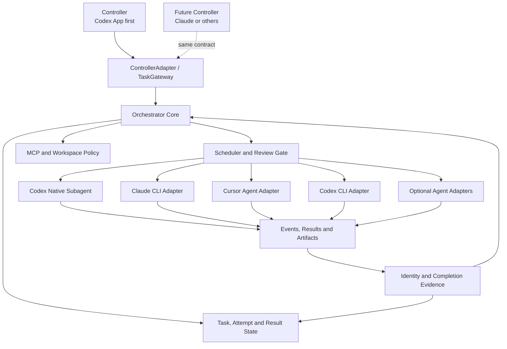

# 多 Agent 协同 Workflow：本机探索、方案对齐与初步设计

**日期**：2026-08-06
**状态**：研究基线和初步设计输入，不是最终实施方案
**当前主控候选**：ChatGPT/Codex App
**研究范围**：Codex App 原生 Subagent、Codex CLI、Claude Code、Cursor Agent CLI、Antigravity CLI，以及 CCG、oh-my-openagent（OMO）、Claude Codex Bridge（CCB）源码实践

关联个案研究：

- [CCG Workflow 多 Agent 实现研究](./2026-08-06-ccg-workflow-multi-agent-study.md)
- [oh-my-openagent 多 Agent 实现研究](./2026-08-06-oh-my-openagent-multi-agent-study.md)
- [Claude Codex Bridge 多 Agent 实现研究](./2026-08-06-claude-codex-bridge-multi-agent-study.md)

## 1. 文档目的与证据边界

本文将当前长对话中的探索结果和初步方案落盘，作为后续编写正式方案、实现 Skill 和设计测试矩阵的输入，避免对话压缩后丢失已经验证的事实。

本文使用以下标签区分结论性质：

- **已对齐**：用户已经用明确语句确认的方向或约束。
- **已实测**：本机命令、模型或原生 Subagent 已经实际运行并得到结果。
- **源码事实**：由当前磁盘源码和测试直接证实。
- **研究建议**：根据实测和源码研究得出的设计建议，仍可在正式方案阶段调整。
- **待决定**：尚未获得明确选择，不应被当成已确认需求。

### 1.1 上下文缺口

对话早期存在若干仅保留为 `C`、`A`、`方案一` 的用户答复，但相应问题文本已不在当前上下文中。对原问题的含义无法可靠恢复，因此本文不猜测这些选项代表什么。

本文所称“已对齐方案”仅依据后续仍完整可见的用户明确表述、同一会话中的实测结果以及本轮源码研究。后续若找到早期问题原文，应重新核对是否需要补充或修订。

## 2. 目标与已对齐约束

### 2.1 总体目标

**已对齐**：构建自己的多 Agent 协同 Workflow，不直接采用 CCG、OMO 等完整框架。当前优先考虑做成可复用 Skill，由主控 Agent 根据任务类型调用其他 Agent 执行探索、方案讨论、代码或文档编写、评审、修复和复审。

### 2.2 当前主控与执行端

**已对齐**：第一版以 ChatGPT/Codex App 为主控，但不能把核心协议写死为“只有 Codex 能当主控”。未来需要允许 Claude Code 或其他主控调用 Codex，因此应提前预留主控接口，第一版可以不实现其他主控。

**已对齐**：当前可用执行端包括：

- Codex App 原生 Subagent；
- Claude Code，当前接入 DeepSeek；
- Cursor Agent CLI；
- Codex CLI，主要作为非 Codex 主控调用 Codex，以及原生 Subagent 暂不支持某些模型时的补充路径；
- Antigravity 可作为可选执行端，但当前账号不可用；
- OpenCode、Kilo 等仅在现有路径确实阻塞时再评估，不作为第一版前置依赖。

### 2.3 Codex 原生 Subagent

**已对齐**：Codex App 调用 Codex Subagent 使用 App 原生多 Agent 能力，不通过 shell 再启动 `codex` CLI。该路径不需要复制 CLI wrapper，只需要通过任务协议、角色规则、文件 ownership、评审独立性和完成条件加以约束。

这意味着后续设计中必须区分：

- `codex-native`：当前 Codex App 内的原生协同路径；
- `codex-cli`：由其他主控调用 Codex，或选择原生协同暂不支持的模型时使用的非交互 CLI 路径。

两者不能被合并为同一种运行机制。

### 2.4 模型与任务路由

**已对齐**：模型不能按角色永久写死。执行代码、文档编写、探索和评审时，主控应能按任务指定 Agent、模型和 reasoning/effort。

当前已明确关注的组合包括：

- Cursor：`cursor-grok-4.5-high`，不启用 Fast；
- Claude Code：`deepseek-v4-pro`；
- Codex App 原生 Subagent：当前可用的 Sol/Terra 路径，可按任务设置 reasoning；
- Codex CLI 补充路径：`gpt-5.6-luna` + `max` reasoning。

角色、任务类型、模型和 provider 应是可扩展字符串或能力声明，不应在 schema 中限制成一组永远不变的枚举。

### 2.5 状态与后续系统集成

**已对齐**：第一版不引入 SQLite。后续文档工作流计划统一接入 SQLite 和看板页面系统，届时再将多 Agent 运行状态、文档任务状态和看板数据统一接入。

因此第一版应先定义 `TaskStore` 或等价接口，但不固化数据库实现。短期只需保存必要的运行结果和可审计产物，不建立第二套最终状态系统。

### 2.6 MCP

**已对齐**：外部 Agent 不应默认启动用户全量 MCP。每个任务只加载声明需要的 MCP，未声明时应尽量使用空或最小 MCP 集合。

这既是性能要求，也是隔离要求：不同任务、session 或 Agent 不应因为共享全局 MCP 配置而产生额外进程、上下文污染或权限扩大。

### 2.7 可运行性

**已对齐**：第一版不是只输出理论接口；当前纳入范围的主要路径都应有实际 smoke test。不能在未跑通时直接宣布某个 provider 不可行，应先检查 CLI help、官方用法、配置隔离方法和错误原因，再决定降级或移出范围。

## 3. 本机探索结论

### 3.1 当前 CLI 版本与非交互入口

2026-08-06 再次读取本机 help，当前版本如下：

| 执行端 | 当前版本 | 非交互入口 | 当前结论 |
|---|---:|---|---|
| Claude Code | `2.1.218` | `claude -p` / `claude --print` | 官方 help 明确说明交互是默认行为，`-p` 才是打印结果并退出 |
| Cursor Agent | `2026.08.04-aaa8809` | `agent -p` / `agent --print` | 应调用独立的 `agent` CLI；直接调用 Cursor 图形入口不是预期路径 |
| Codex CLI | `0.144.1` | `codex exec` / `codex e` | `codex -p` 中的 `-p` 是 profile，不是 print |
| Antigravity | `1.1.8` | `agy -p` / `agy --print` | 当前 CLI 支持 text/json/stream-json；当前账号不可用，未在本轮重新完成真实模型调用 |

这些 help 查询只读取命令声明，没有修改配置。

### 3.2 Claude Code

**已实测**：使用 `claude -p` 可以非交互执行并返回结果；`deepseek-v4-pro` 已经成功完成对话。此前直接使用 `claude "Hi"` 进入交互界面，是因为没有使用 `-p`，不是 Claude Code 不支持 headless。

建议的调用形态：

```powershell
claude -p "<task>" `
  --model deepseek-v4-pro `
  --output-format stream-json `
  --verbose `
  --mcp-config <task-mcp-config.json> `
  --strict-mcp-config
```

其中：

- `--strict-mcp-config` 保证只读取本次显式提供的 MCP；
- 可结合 `--bare`、`--setting-sources ""`、`--tools`、`--allowed-tools` 和 `--disallowed-tools` 进一步控制 hooks、skills、配置来源和工具；
- 不应像 CCG 那样默认加入 `--dangerously-skip-permissions`；权限策略应由任务显式声明。

### 3.3 Cursor Agent CLI

**已实测**：Cursor 的非交互入口是独立的 `agent -p`，不是用 `cursor` 命令启动桌面界面。`cursor-grok-4.5-high` 已经成功返回结果，且没有启用 Fast。

2026-08-06 的 `agent --list-models` 仍同时列出：

- `cursor-grok-4.5-high`
- `cursor-grok-4.5-high-fast`

因此选择无 `-fast` 后缀的模型即可表达“不启用 Fast”。

建议的调用形态：

```powershell
agent -p "<task>" `
  --model cursor-grok-4.5-high `
  --output-format stream-json `
  --workspace <workspace>
```

Cursor help 暂未提供与 Claude `--strict-mcp-config` 完全等价的单次调用参数。此前验证的隔离方向是使用任务专属的临时配置目录或 home，使该进程只能看到为任务准备的 MCP 配置。正式方案需要把这一点封装在 Cursor Adapter 内，不能要求 Prompt 自觉忽略已加载 MCP。

### 3.4 Codex App 原生 Subagent

**已实测**：Codex App 原生 Subagent 调用链路可用。本轮 CCG、OMO、CCB 三个研究任务均由 `gpt-5.6-terra`、`medium` reasoning 的原生 Subagent 完成并分别落盘；此前 `gpt-5.6-terra`、`max` 探针也成功返回 task canary。

此前模型目录研究显示：当前 App 原生多 Agent 可选择范围与模型条目的 `multi_agent_version` 有关；Sol/Terra 可作为原生 Subagent，而 Luna 当前未出现在原生 Subagent 可选列表。该结论属于当前 App/模型目录状态，升级后可能变化，不能成为永久限制。

### 3.5 Codex CLI 与 Luna Max

**已实测**：当需要 Luna，而当前 App 原生 Subagent 暂不支持时，可以走：

```powershell
codex exec `
  -m gpt-5.6-luna `
  -c 'model_reasoning_effort="max"' `
  -C <workspace> `
  --json `
  "<task>"
```

当前 CLI help 再次确认：

- `codex exec` 是官方非交互入口；
- `-m` 选择模型；
- `-c key=value` 覆盖配置；
- `--json` 输出 JSONL 事件；
- `-p` 表示 `--profile`，不是 print；
- 可使用 `--ignore-user-config`、`--ephemeral`、sandbox 和 approval 参数控制隔离与持久化。

关于账号风险，现有结论是：`codex exec` 本身是官方提供给脚本和非交互场景的入口。正常使用官方客户端、本人账号和合理并发的多 Agent 调用，不应被等同于非官方逆向接口。仍应避免共享凭据、绕过服务限制、异常高并发或批量滥用。

### 3.6 Antigravity

用户此前已经运行过：

```powershell
agy -p "<task>"
```

并能直接获得打印结果。当前本机 `agy --help` 也确认 `-p` 是非交互 print 模式，支持 `--model`、`--agent`、`--effort`、`--output-format`、`--conversation` 和 `--sandbox`。

当前账号已经不可用，因此本轮只验证了 CLI 能力声明，没有重新验证真实模型返回。CCG 源码也证实 Antigravity 不读取 stdin prompt，调用时必须使用 `-p`，这应记录为 Adapter capability，而不是在通用执行器中猜测。

## 4. CCG、OMO 与 CCB 研究综合结论

### 4.1 三个项目的定位

| 维度 | CCG | OMO | CCB | 对本项目的意义 |
|---|---|---|---|---|
| 核心形态 | Claude 主控、Prompt 模板和 Go CLI wrapper | 完整多 harness Agent OS | 常驻 daemon、tmux/TUI 与跨 Provider 协作层 | CCG 参考短任务执行面，OMO 参考控制状态，CCB 参考长期运行时可靠性边界 |
| Provider 接入 | 最小 `Backend` 和显式 registry | model/category/provider/fallback 多层路由 | manifest、execution、session binding、launcher 组成 `ProviderBackend` | 第一版采用轻量 Adapter，但保留 capability、session identity 和恢复校验 |
| 任务状态 | 很多依赖 Prompt 自觉落盘 | 明确状态机、父子关系、attempt 和恢复 | message、attempt、reply、inbound event 和 job 分离 | 第一版显式区分 task、attempt、result，避免重试覆盖历史 |
| 并发与路由 | 依赖拓扑分层，同层并行 | provider/model FIFO 队列，可取消 waiter | 按 agent 路由、每 target 建 job；mailbox 设计强调单接收者串行 | 不按 provider 名称路由；不同隔离键可并行，同一接收者默认串行 |
| 完成与恢复 | 解析流和 session ID | child terminal、父任务 wake 与交付去重 | completion、pane health、session binding、authority fingerprint 分层 | 进程退出、任务完成和结果已交付必须是不同证据 |
| MCP/环境 | 偏安装和全局配置同步 | skill/session 作用域和连接回收 | 主要依赖 startup args、私有 HOME 和 provider 配置投影 | 第一版保留显式 MCP 字段和隔离能力，不复制私有 HOME 全套系统 |
| 评审 | 多数为 Prompt 约定 | 部分由 hook 和 gate 强制 | 不是其核心抽象 | 第一版由主控状态机强制独立评审 |
| 主要风险 | 全局污染、危险权限默认、协议偏文本 | OpenCode 特有状态机和 hook 复杂度 | daemon/tmux、pane/session 恢复与私有状态复杂度 | 三者都只借机制，不复制产品形态 |

### 4.2 可以直接吸收的机制

1. **CCG 的 Adapter 边界**：将可执行文件发现、参数构造和 provider 差异集中管理。
2. **CCG 的 Session ID 早期捕获**：即使任务超时，也能保留真实 session ID 供 resume。
3. **CCG 的进程超时和 Windows 进程树清理**：外部 CLI 可能留下持有 stdout 的子进程。
4. **OMO 的显式任务状态**：至少包含 `pending/running/completed/failed/cancelled/timed_out`。
5. **OMO 的并发 waiter 取消**：取消任务必须同时清理业务队列和并发等待项。
6. **OMO 的父任务通知去重**：结果通知需要 idempotency、defer 和 delivery 状态。
7. **OMO 的每 session MCP 隔离**：连接键包含 session、skill 和 server，并在 session 结束后回收。
8. **CCB 的 ProviderBackend 组合边界**：execution、session binding 和 launcher 属于同一 provider 单元，但保持职责分离。
9. **CCB 的 task/attempt/reply 分离**：重试创建新 attempt，不覆写原始请求和历史结果。
10. **CCB 的身份与 authority 校验**：resume 前核对 provider session、配置 authority 和运行时绑定，变化时拒绝误续接。
11. **CCB 的完成证据分层**：provider/pane 存活只说明运行时健康，不能单独证明任务完成或回复已安全交付。
12. **独立 reviewer gate**：是否通过由结构化 finding 和证据判断，不由 worker 自证。

### 4.3 应简化后吸收

- 使用 JSON 或类型化对象作为任务协议，不复制 CCG 的 `---TASK---` 文本分隔格式。
- 仅实现一套清晰的 fallback/retry policy，不复制 OMO 相互独立的 proactive/runtime fallback。
- 第一版以显式 `wait(taskId)` 为主，不复制 OMO 完整的自动 parent-wake 状态机。
- 第一版不实现 CCB 式完整文件 mailbox；原生 Subagent 使用宿主消息 API，CLI Agent 使用进程事件、结构化结果和受校验的 session resume。
- 使用轻量 `authority_version`、非秘密配置摘要、launch nonce 和 provider session ID，不复制 CCB 对 HOME/auth/config 的全量投影与历史管理。
- 同一逻辑 Agent 的入站任务默认串行；只有不同 Agent 且隔离键明确不同的任务才允许并行。
- worktree 作为可选的 workspace policy，只在并行写入确有冲突风险时启用。
- MCP 先实现 task/session allowlist、namespace、启动超时和回收，不复制 OAuth 和三级 MCP 体系。

### 4.4 不应复制

- CCG 对 Claude、Codex、Grok 默认绕过权限的行为；
- CCG 将 commands、hooks、skills 和 MCP 大量写入全局用户配置的分发方式；
- CCG 每个 CLI 任务默认启动浏览器 SSE 页面；
- OMO 的 50 多个 hooks、42 个 package、tmux team layout 和长期 team runtime；
- CCB 的常驻 daemon、tmux 多窗口、pane ownership/reflow/reconnect 控制面；
- CCB 为多 Provider 长期会话建立的完整私有 HOME、asset projection、socket health 和 dead-letter/mailbox 系统；
- 通过 Prompt 文本、Agent 名称正则或工具名称猜测角色、协议和兼容版本；
- 将“Agent 声称完成”当作状态或质量证据。

## 5. 初步设计

以下内容是结合已对齐约束和研究结果形成的**初步设计**，后续仍需单独评审后再实施。



### 5.1 Skill 层

Skill 负责表达编排规则，而不是重新实现一个完整 Agent 平台：

- 判断任务是探索、方案讨论、执行、评审还是修复；
- 选择一个或多个 Agent、模型、reasoning、MCP 和 workspace policy；
- 生成结构化任务；
- 等待并收集结果；
- 根据 gate 决定完成、修复、复审或降级；
- 输出统一总结和证据位置。

Skill 不应直接拼接每个 CLI 的 shell 命令。具体调用由 Adapter 处理。

### 5.2 ControllerAdapter

`ControllerAdapter` 只负责把宿主原生能力映射到稳定的 `TaskGateway`。这样 Codex App 可以使用原生 Subagent，未来 Claude Code、人工 CLI 或服务也能通过同一协议调用 Codex，而 Orchestrator 不依赖某个宿主的工具名。

```text
TaskGateway
  submit(taskRequest) -> taskHandle
  observe(taskHandle, cursor) -> taskEvents
  send(taskHandle, message) -> deliveryReceipt
  cancel(taskHandle) -> cancelReceipt
  capabilities() -> controllerCapabilities
```

第一版只实现 Codex App 的 `ControllerAdapter`。`taskHandle` 中的 provider 引用必须保持 opaque，不能把 Codex thread ID 当成全局任务 ID；跨层关联统一使用协议自己的 `task_id` 和 `attempt_id`。

### 5.3 AgentAdapter

```text
AgentAdapter
  id
  capabilities()
  validate(task)
  buildInvocation(task, attempt)
  launch(invocation) -> providerHandle
  observe(providerHandle, cursor) -> rawEvents
  extractIdentity(rawEvents) -> providerIdentity
  resume(providerIdentity, message)
  cancel(providerHandle)
  parseEvent(raw)
  cleanup(providerHandle)
```

首批 Adapter：

- `codex-native`
- `claude-cli`
- `cursor-agent-cli`
- `codex-cli`
- `antigravity-cli`，可选且当前标记为账号不可用

`codex-native` 是对宿主原生能力的薄映射，不能通过 shell 启动 Codex。

逻辑 Agent 与 Provider 必须分开：任务路由目标是 `to_actor`，Adapter/模型只是本次 attempt 的执行选择。不能因为两个角色使用同一 Provider，就把它们视为同一个收件人或共享同一 session。

### 5.4 Task、Attempt 与 Completion 契约

`TaskEnvelope` 保存不可变的任务意图，建议至少包含：

```yaml
version: 1
task_id: stable-id
parent_task_id: optional
from_actor: controller
to_actor: explorer-1
role: explorer-or-worker-or-reviewer
objective: full task
execution_policy:
  preferred_adapter: codex-native
  allowed_adapters: [codex-native]
  preferred_model:
    id: gpt-5.6-terra
    reasoning: medium
  allow_fallback: false
permissions:
  mode: read-only
workspace:
  mode: shared
  path: E:/project
mcp:
  allow: [codegraph]
timeout_seconds: 1800
retry:
  max_attempts: 1
expected_output:
  format: markdown
```

字段值不应被上述示例限制死。`role`、`to_actor`、Adapter、模型、MCP 和 expected output 都应允许扩展。`execution_policy` 表达本任务的偏好、允许范围和 fallback 授权，不是实际执行事实；主控也可以按任务将某个模型设为唯一允许值。

每次实际执行创建新的 `AttemptRecord`，至少保存：

```yaml
attempt_id: stable-attempt-id
task_id: stable-id
attempt_index: 1
adapter: codex-native
model_id: gpt-5.6-terra
launch_nonce: random-nonce
provider_session_id: optional-opaque-id
authority_version: optional
authority_fingerprint: optional-non-secret-digest
workspace_canonical_path: E:/project
status: running
```

`AttemptRecord.adapter` 和 `AttemptRecord.model_id` 是该次执行实际采用值的唯一事实源。重试只能新建 attempt，不覆写上一轮的执行选择、provider session、错误、部分结果和 artifact；fallback 只有在 `execution_policy` 允许时才能选择其他 Adapter/模型。若 provider authority、配置摘要、workspace 或 session binding 与保存值不一致，默认拒绝 resume，转为新 attempt。

Adapter 的最终输出统一归一化为：

```text
CompletionDecision
  terminal
  status
  reason
  confidence
  reply
  artifacts
  evidence
```

`completed` 必须来自 provider/session/turn/输出证据的组合。只有进程退出、pane 存活或 Agent 文本声称“完成”，都不足以单独产生成功状态。

### 5.5 运行状态

第一版最小状态：

```text
created → queued → running
                   ├→ completed
                   ├→ failed
                   ├→ incomplete
                   ├→ timed_out
                   └→ contaminated

running → cancel_requested → cancelled
```

每次 attempt 记录：

- Adapter 和模型；
- provider session ID；
- 开始/结束时间；
- exit code 和结构化错误；
- 最终消息；
- launch nonce、非秘密 authority 摘要和身份核验结果；
- completion reason、confidence 和原始证据引用；
- 日志、diff、测试、评审等 artifact 引用。

暂不实现 SQLite。状态访问通过接口封装，使后续可以整体切换到 SQLite 和看板系统。

### 5.6 典型流程

#### 探索或方案讨论

```text
主控拆分独立问题
→ 并行派发只读 Agent
→ 等待全部必要结果
→ 主控核对冲突与证据
→ 综合结论
```

#### 实施和评审

```text
主控定义任务和文件 ownership
→ worker 实施并验证
→ 独立 reviewer 读取真实 diff/文件
→ 无阻断问题：完成
→ 有阻断问题：交回 worker 修复
→ reviewer 复审
```

角色不是固定模型。相同的 reviewer 任务可以根据成本、可用性和风险路由给不同 Agent，但 reviewer 不能直接依赖 worker 的总结。

### 5.7 MCP 和环境隔离

每个 Adapter 都必须显式报告能力：

```text
supports_stdin
supports_stream_json
supports_resume
supports_model_override
supports_reasoning_override
supports_strict_mcp
supports_config_isolation
supports_native_cancel
supports_provider_identity
supports_resume_authority_check
```

MCP 默认策略：

1. 任务没有声明 MCP：使用空或最小集合；
2. 任务声明 MCP：仅启动 allowlist；
3. session 结束：回收本次启动的 MCP；
4. 不覆盖用户全局配置；
5. 不把密钥写入任务 artifact 或仓库。

CCB 的实现进一步说明：不同 Provider 的模型、MCP、权限和配置隔离方式差异很大，不能把 shell 参数字符串当成跨 Provider 协议。任务层保存声明式 `model`、`mcp`、`permissions` 和可选 `config_ref`，由 Adapter 构造 argv、env 和临时配置。

### 5.8 身份、canary 与污染防护

CCB 已实现 session authority、runtime binding 和 tmux pane ownership 等身份证据，但其源码中没有 `TASK_CANARY`。因此 canary 是本项目在这些机制基础上的新增协议，不应归因为 CCB 功能。

第一版建议每个 attempt：

1. 生成不可复用的 `launch_nonce`；
2. 在任务前缀中要求 Agent 首条输出回显 `task_id/attempt_id/launch_nonce`；
3. 同时核对宿主 task handle、provider session ID、workspace canonical path 和可获得的 provider identity；
4. 任一关键身份不匹配时标记为 `contaminated`，保存证据并隔离当前 session/process；
5. contamination 不在同一 session 上自动 retry，必须新建 attempt 或交回主控判断。

canary 不是唯一证据。能提供原生 task/session identity 的宿主仍应以结构化身份为准；无法提供时，canary 只能作为最低限度的串线探针，不能替代权限、workspace 和结果证据检查。

并发隔离规则：

- 同一 `to_actor` 的入站任务默认串行；
- 调度并发键至少考虑 Adapter、provider profile/session namespace 和 workspace；
- 已知宿主若会让同 Provider 的 worktree Agent 共享 session 或 pane，则默认串行或改用独立 Provider/非 worktree 通道；
- 上述共享风险来自目标宿主的运行时约束，不是 CCB 源码证明的行为。CCB 自身的设计目标反而是隔离 provider HOME、session 和 pane ownership。

### 5.9 权限和 workspace

权限和 workspace 是任务字段，不由 Adapter 擅自扩大：

- 探索、方案讨论、评审默认只读；
- worker 可写，但限定 workspace 和 ownership；
- 并行写入存在冲突风险时才使用 worktree；
- 不默认添加 bypass/yolo/dangerous flags；
- 如果 headless 执行确实需要更高权限，应由主控依据隔离环境和任务风险显式选择。

## 6. 第一版候选范围

### 6.1 建议纳入

- 一个多 Agent orchestration Skill；
- 可扩展 TaskEnvelope、AttemptRecord、CompletionDecision 和 Event schema；
- Codex App 原生 Subagent 路径；
- Claude CLI Adapter；
- Cursor Agent CLI Adapter；
- Codex CLI Adapter，支持 Luna Max 补充路径和未来外部主控；
- task/model/reasoning/MCP/workspace/permission 的逐任务覆盖；
- 有限并行、单接收者串行、超时、取消、日志和 session ID；
- launch nonce、task canary、provider identity 和轻量 authority 校验；
- explorer/worker/reviewer/fix/re-review 的规则与 gate；
- 每条 Adapter 的真实 smoke test 和诊断输出。

### 6.2 暂不纳入

- SQLite；
- 看板页面；
- 常驻 daemon；
- 文件 mailbox；
- tmux 多窗格团队 UI；
- pane ownership、reflow、socket health 和长期 session recovery 控制面；
- CCB 式完整私有 HOME/asset projection 与 provider cache 生命周期；
- 完整 team runtime；
- 自动发现并启动所有 MCP；
- OpenCode、Kilo 等新 provider 的正式实现；
- OMO 式多层 fallback、OAuth MCP 和全局配置迁移系统。

## 7. 验证建议

正式实现时，每个 Adapter 至少验证：

1. help/version 探测；
2. 非交互返回；
3. 指定模型和 reasoning；
4. text/json/stream-json 解析；
5. workspace/cwd；
6. 只读与可写权限；
7. 空 MCP 和单一指定 MCP；
8. timeout 和取消；
9. session ID 捕获、authority 不变时 resume，以及 authority 改变时拒绝误续接；
10. task/attempt 分离，重试不覆盖历史证据；
11. task canary 和 provider/workspace identity 匹配，错配时进入 `contaminated`；
12. 空回复、仅进程退出或仅 runtime 存活不会误判为 `completed`；
13. 同一逻辑 Agent 串行，不同隔离键可以有限并行；
14. Windows 下无额外交互窗口、无孤儿进程；
15. Windows 状态写入不依赖 POSIX `O_DIRECTORY`，原子写策略有平台测试；
16. 日志不包含 token、认证头和配置密钥；
17. worker 和 reviewer 使用独立任务上下文。

第一版的“跑通”应以保存 smoke test 结果为准，不能仅以 CLI help 存在或 Agent 口头声明为准。

## 8. 已知风险与待决定项

### 8.1 已知风险

- CLI 参数和 stream event schema 会随版本变化，Adapter 需要 version probe 和 parser fixture。
- Windows 下 stdin、`.cmd` 包装器、cwd 和进程树行为不能按 Unix 假设。
- 用户全局配置可能隐式加载 hooks、skills、rules 和 MCP，必须有隔离策略。
- 任务完成、进程退出和结果已安全交付不是同一个事件。
- session ID 相同也不代表 provider authority、workspace 和上下文仍然相同，resume 必须先校验身份摘要。
- canary 只能发现部分串线，不能替代宿主 task/session identity 和结构化完成证据。
- 同 Provider/worktree 是否共享 session、pane 或缓存取决于具体宿主，需要逐 Adapter 实测，不能从 CCB 的隔离目标反推。
- CCB 聚焦测试在当前 Windows 上有 2 项因 `O_DIRECTORY` 目录 fsync 不可用而失败；第一版文件状态存储不能照搬 POSIX 耐久写实现。
- 自动 fallback 可能重复执行有副作用的任务，必须结合 idempotency 和 workspace 状态。
- Codex App 原生 Subagent 的可选模型列表可能随 App 和模型目录更新而改变。

### 8.2 待决定

- 第一版 Skill 的正式名称和安装位置；
- Task/Attempt/Completion/Event schema 的最终字段和版本策略；
- 第一版运行 artifact 的目录布局与保留周期；
- 外部 CLI 默认 sandbox/approval policy；
- 单 provider 和全局并发默认值；
- 哪些任务允许自动 retry，哪些必须回到主控判断；
- authority fingerprint 第一版包含哪些非秘密字段，以及版本变化策略；
- 不同 Adapter 的并发隔离键和同 Provider 默认并发值；
- 第一版是否提供最小命令行 wrapper，还是仅由 Skill 内脚本承载 Adapter；
- 后续 SQLite/看板接入时由哪个项目维护 schema 和迁移。

## 9. 当前结论

当前最合适的方向不是复制 CCG、OMO 或 CCB，而是：

> 用 CCG 风格的轻量 CLI Adapter 解决“如何稳定调用不同 Agent”，用 OMO 简化后的任务状态、并发取消、结果交付和 MCP 隔离契约解决“如何可靠协同”，再吸收 CCB 的 task/attempt/reply 分离、session authority 和完成证据边界解决“如何避免误续接、串线和伪完成”；Codex 对 Codex 优先走 App 原生 Subagent，CLI 路径作为跨主控和模型覆盖补充。

该方向同时满足：

- 当前可以由 Codex App 直接主控；
- Claude Code、Cursor 和 Codex CLI 可按任务路由；
- 模型、reasoning 和角色不被写死；
- MCP 不默认全量启动；
- 第一版不引入 SQLite；
- 第一版不引入 daemon/tmux，但保留可演进的身份、attempt 和事件接口；
- 未来可以接入其他主控、SQLite 和看板，而不推翻第一版核心协议。
